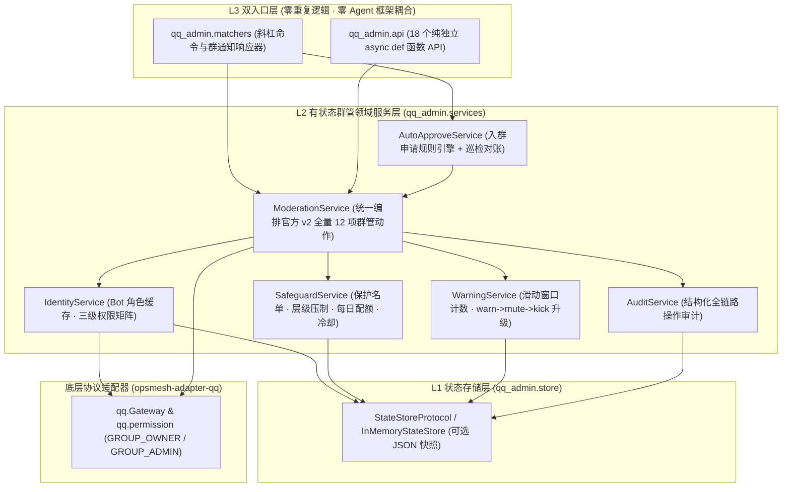

# opsmesh-plugin-qq-admin

面向 **[OpsMesh](https://github.com/jhupo/OpsMesh)** 与 **[opsmesh-adapter-qq](https://github.com/jhupo/opsmesh-adapter-qq)** 的腾讯官方 QQ 机器人 v2 群聊管理插件与对外独立异步函数 API（顶层导入包名：`qq_admin`）。

本项目完整消费 `opsmesh-adapter-qq` 封装的**官方 v2 全量 12 项群管原子接口**与群通知事件：
- **对群聊用户**：提供开箱即用的斜杠管理命令面板（`matchers/`）与入群申请自动审批；
- **对上游业务 / Agent 框架**：直接通过顶层包 `qq_admin`（采用 OpsMesh 风格的 `from ... import X as X` 显式导出）暴露 **19 个强类型异步函数 API**，零多余转发层、零第三方 Agent/Tool 框架耦合，上游可按需自由封装为 OpenAI Agents SDK `@function_tool`、MCP Tool 或 HTTP 接口。

---

## 核心特性

- **18 个纯独立对外异步函数 API（零 Tool 框架绑定、零 `build_*` 闭包）**：
  - `src/qq_admin/api/` 下每个文件只提供一个独立 `async def` 函数，统一接收 `AdminContext` 并返回结构化 `ModerationOutcome`；
  - 既支持 `from qq_admin import mute_member, kick_member` 直接调用，也可由依赖方自由包一层 `@function_tool` 接入 OpenAI Agents SDK 或其他框架。
- **命令与对外 API 共享单一领域护栏（`matchers/` + `api/` -> `services/`）**：
  - 人工斜杠命令与外部函数调用共用同一条 `IdentityService -> SafeguardService -> ModerationService -> AuditService` 管线，杜绝规则分叉或越权调用。
- **六重高危动作安全护栏**：
  - 操作者身份（`SUPERUSER | GROUP_OWNER | GROUP_ADMIN`）× 机器人本群角色（`owner | admin | member`）双重鉴权；
  - 受保护成员白名单（`protected_openids`）、角色层级压制保护、单群每日禁言/踢人/拉黑/审批配额上限、目标级冷却窗口与禁言时长上下界截断。
- **滑动窗口违规计数与阶梯升级**：
  - 按 `(group_openid, member_openid)` 记录 `spam` / `abuse` / `ad` 违规事件，窗口内自动触发 `警告 -> 定时禁言 -> 踢出群聊` 阶梯处置。
- **事件驱动 + 巡检补偿入群自动审批**：
  - 实时响应 `GroupJoinRequestEvent`（暗号答案匹配、平台 `risk_tips` 风险拦截、受信任邀请人白名单），支持定时 `get_group_join_request_list` 漏单补偿。

---

## 系统架构总览



---

## 目录结构

```text
opsmesh-plugin-qq-admin/
├── .github/workflows/          # CI (Linux/Windows × Py3.11-3.13) · CodeQL · Security · Release
├── docs/                       # 架构、18 个对外异步 API 契约与安全护栏时序文档
│   ├── 01-architecture-and-config.md
│   ├── 02-public-async-apis.md
│   └── 03-safeguard-and-workflows.md
├── examples/admin_bot/         # 集成示例工程
├── src/qq_admin/               # 顶层导入包 (opsmesh.load_plugin("qq_admin"))
│   ├── __init__.py             # PluginMetadata、init_plugin 与全部 19 个函数 API 显式导出
│   ├── py.typed                # PEP 561 静态类型标记
│   ├── typing.py               # RoleTier · ViolationType · EscalationAction · AuditSource
│   ├── exception.py            # 权限不足、配额耗尽、目标受保护等领域异常
│   ├── config.py               # 分区强类型配置 QQAdminConfig
│   ├── context.py              # OperatorIdentity · AdminContext · ModerationOutcome
│   ├── store/                  # protocol.py · memory.py
│   ├── services/               # identity · safeguard · warning · audit · moderation (含 19 项公开异步函数) · auto_approve
│   └── matchers/               # panel · moderation · blacklist · approval · query
└── tests/unit/                 # 单元测试套件
```

---

## 设计文档导航

1. **[01-architecture-and-config.md](docs/01-architecture-and-config.md)** — 插件四层架构、单向依赖 DAG、`PluginMetadata` 挂载契约、分区配置表与 `StateStoreProtocol`。
2. **[02-public-async-apis.md](docs/02-public-async-apis.md)** — 全量 18 个对外独立异步函数 API 契约清单，以及在依赖侧按需封装 OpenAI Agents SDK `@function_tool` 的极简示例。
3. **[03-safeguard-and-workflows.md](docs/03-safeguard-and-workflows.md)** — 双重权限判定矩阵、六阶段安全护栏流程图、违规阶梯升级状态机、命令/API 统一执行与自动审批时序图。

---

## 开源许可

本项目采用 [MIT License](LICENSE) 开源。
