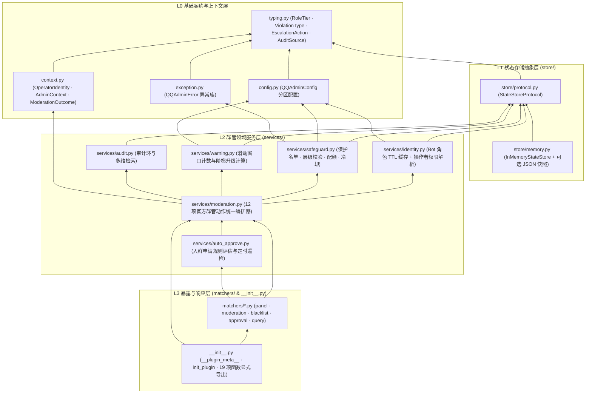

# 01. 插件四层架构、配置契约与状态存储设计

本文档定义 `opsmesh-plugin-qq-admin`（顶层包名 `qq_admin`）的分层边界、模块依赖关系、OpsMesh 插件元数据声明、分区配置模型以及可插拔状态存储接口。

---

## 1. 为什么群管业务必须作为独立插件而非塞入适配器

| 维度 | `opsmesh-adapter-qq`（协议适配器层） | `opsmesh-plugin-qq-admin`（群管业务插件层） |
| :--- | :--- | :--- |
| **状态属性** | 无状态（仅维护传输层连接、Token 缓存与被动回复 `msg_seq`） | **强有状态**（违规计数窗口、每日踢人/禁言配额、冷却锁、分群开关、审计日志） |
| **关注点** | 腾讯官方 HTTP/WSS 报文编解码、签名校验、`QQAction` 原子调用 | 权限分级策略、防误伤安全护栏、惩罚阶梯升级、入群审批规则与 LLM 工具暴露 |
| **可组合性** | 任何只做问答/通知的 QQ 机器人均可零负担安装 | 需要群管或 AI 自治管群时按需 `opsmesh.load_plugin("qq_admin")` |
| **依赖方向** | 仅依赖 `opsmesh` 核心 | 单向依赖 `opsmesh` + `opsmesh-adapter-qq` |

---

## 2. 四层单向无环依赖图（DAG）



---

## 3. OpsMesh 插件入口契约（`src/qq_admin/__init__.py`）

通过 `PluginMetadata` 原生接入 OpsMesh 插件管理器，声明仅绑定 `qq` 适配器并自动注入 `QQAdminConfig`：

```python
from opsmesh.plugin import PluginMetadata, get_plugin_config

from .config import QQAdminConfig

__plugin_meta__ = PluginMetadata(
    name="QQ 官方群管插件",
    description="基于腾讯官方 QQ 机器人 v2 全量群管 API 的命令面板、自动审批与独立 LLM 工具集",
    usage="/admin status | /mute | /kick | /ban | /requests",
    type="application",
    homepage="https://github.com/jhupo/opsmesh-plugin-qq-admin",
    config=QQAdminConfig,
    supported_adapters={"qq"},
)
```

---

## 4. 分区强类型配置契约（`src/qq_admin/config.py`）

遵循单一职责，避免扁平大字典，按子域拆分为 5 个 `BaseModel` 并汇总到 `QQAdminConfig`（环境变量前缀 `QQ_ADMIN_`）：

| 配置分区模型 | 核心字段 | 默认值 | 职责说明 |
| :--- | :--- | :---: | :--- |
| `GroupSwitchConfig` | `enabled_by_default` / `enabled_groups` / `disabled_groups` | `True` / `set()` / `set()` | 分群启用开关与黑白名单 |
| `SafeguardConfig` | `protected_openids` | `set()` | 绝对免罚白名单（任何命令与 Tool 禁止对其禁言/踢出/拉黑） |
| `SafeguardConfig` | `min_mute_seconds` / `max_mute_seconds` | `60` / `2592000` | 禁言时长强制上下界（1 分钟 ~ 30 天） |
| `SafeguardConfig` | `daily_mute_quota` / `daily_kick_quota` / `daily_blacklist_quota` | `30` / `10` / `10` | 单群自然日高危写操作配额上限（`SUPERUSER` 可显式豁免） |
| `SafeguardConfig` | `target_cooldown_seconds` | `15` | 同一目标连续写操作最小冷却间隔（防止并发重复处罚） |
| `WarningPolicyConfig` | `window_seconds` | `86400` | 违规滑动统计窗口（默认 24 小时） |
| `WarningPolicyConfig` | `mute_threshold` / `mute_duration_seconds` | `2` / `600` | 窗口内达到第 2 次警告自动升级为 10 分钟禁言 |
| `WarningPolicyConfig` | `kick_threshold` / `kick_with_blacklist` | `4` / `False` | 窗口内达到第 4 次警告自动升级为踢出群聊 |
| `AutoApproveConfig` | `enabled` / `pass_keywords` / `reject_on_risk_tips` | `False` / `[]` / `True` | 入群申请暗号匹配、存在平台 `risk_tips` 时自动转人工或拒绝 |
| `AutoApproveConfig` | `poll_interval_seconds` | `0` | `>0` 时启用后台定时拉取 `get_group_join_request_list` 补偿漏单 |
| `AuditConfig` | `max_records_per_group` / `snapshot_path` | `500` / `None` | 单群内存保留审计条数上限及可选本地 JSON 快照路径 |

---

## 5. 状态存储协议（`src/qq_admin/store/protocol.py`）

所有有状态组件仅依赖异步 `typing.Protocol` 接口 `StateStoreProtocol`，开箱即用零外部依赖的 `InMemoryStateStore`，后续可无缝替换为 SQLite 或 Redis 实现：

- **分群开关**：`is_group_enabled(group_openid) -> bool`、`set_group_enabled(group_openid, enabled)`
- **Bot 角色缓存**：`get_cached_bot_role(group_openid) -> RoleTier | None`、`set_cached_bot_role(group_openid, role, ttl_seconds=300)`
- **每日配额原子递增**：`consume_daily_quota(group_openid, action_key, limit) -> QuotaCheckResult`
- **冷却窗口锁**：`acquire_target_cooldown(group_openid, target_openid, action_key, ttl_seconds) -> bool`
- **滑动窗口违规记录**：`append_violation(record) -> int`、`list_active_violations(group_openid, member_openid, since_ts)`、`clear_violations(group_openid, member_openid) -> int`
- **审计日志环**：`append_audit(record)`、`query_audits(group_openid, limit=20, source=None, action=None)`
