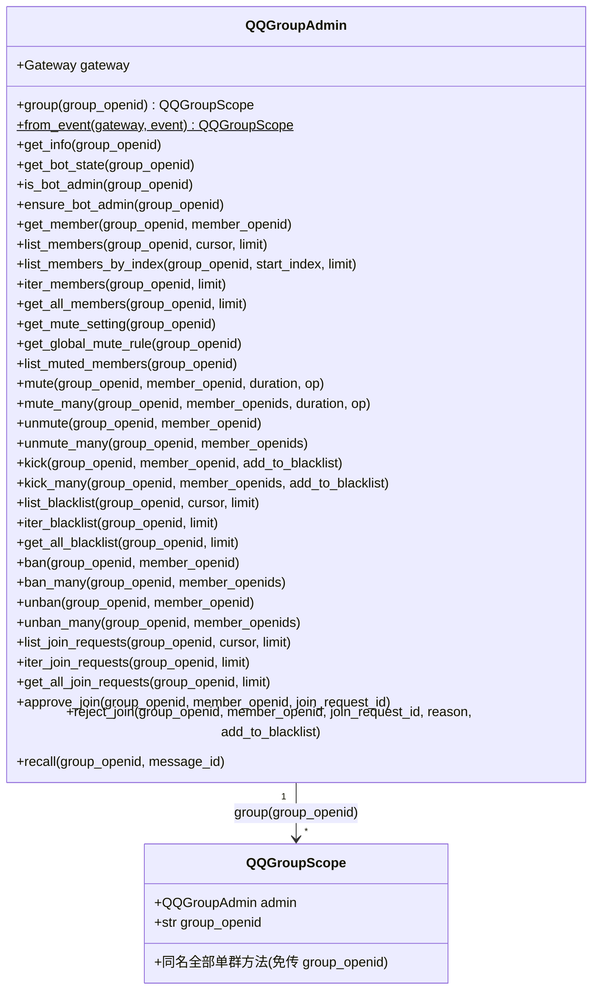

# 01. 架构设计与官方 QQ 群管 v2 能力边界

本文档定义 `opsmesh-plugin-qq-admin` 与 `opsmesh-adapter-qq` 的分工边界及类关系设计。

---

## 1. 双仓分层职责边界

| 仓库 | 定位 | 负责内容 |
| :--- | :--- | :--- |
| **`opsmesh-adapter-qq`** | 底层协议层 | 连接保活、鉴权 Token、OpenID 校验、1:1 官方 HTTP 接口映射 |
| **`opsmesh-plugin-qq-admin`** | 群管理接口类层 | 无状态 `QQGroupAdmin` 与单群视图 `QQGroupScope`、单人/批量语义封装、时长字符串归一化、自动 `next_cursor` 游标翻页、角色层级校验与 OpsMesh `Depends` 注入 |

---

## 2. 核心类关系图

