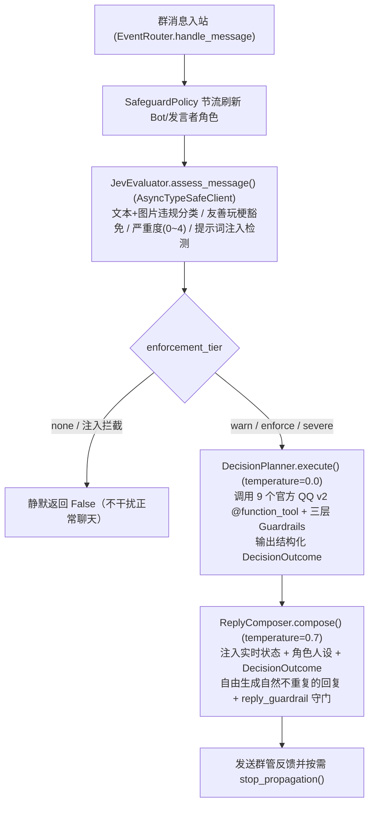

# 01. 架构设计与协作者职责

## 1. 核心数据流（纯群管控制，不抢闲聊）

## 2. 核心协作者组件对照

| 组件 | 位置 | 单一职责 |
| :--- | :--- | :--- |
| `PromptCatalog` | `resources/__init__.py` | 读取外置 `prompts.toml` 并渲染兜底模板 |
| `GroupStateStore` | `state.py` | 内存态角色 TTL 缓存、日配额、冷却、警告滑窗、近期上下文与审计日志 |
| `JevEvaluator` | `jev/evaluator.py` | 持有外部注入或自托管的 `AsyncTypeSafeClient`，提供多模态消息/入群评估与 3 项安全复核 |
| `SafeguardPolicy` | `moderation/policy.py` | 三级命令鉴权、权限决策链追踪与角色感知 8 步硬护栏 |
| `GroupModerator` | `moderation/moderator.py` | 官方 QQ v2 唯一写接口执行器与确定性处罚阶梯 |
| `JoinApprover` | `moderation/approver.py` | 入群申请审批与定时轮询 |
| `DecisionPlanner` | `agents/planner.py` | Agent 1：复用共享 `AsyncOpenAI`，精准编排工具调用 |
| `ReplyComposer` | `agents/composer.py` | Agent 2：结合实时状态与角色提示词自由组织自然回复 |
| `CommandRoute` / `@command` | `commands/registry.py` | 声明式正则命令路由，消除 21 个命令的重复鉴权与切词样板 |
| `AdminRuntime` | `runtime.py` | 组合根，统一管理外部客户端与后台协程的 `startup()` / `shutdown()` |
