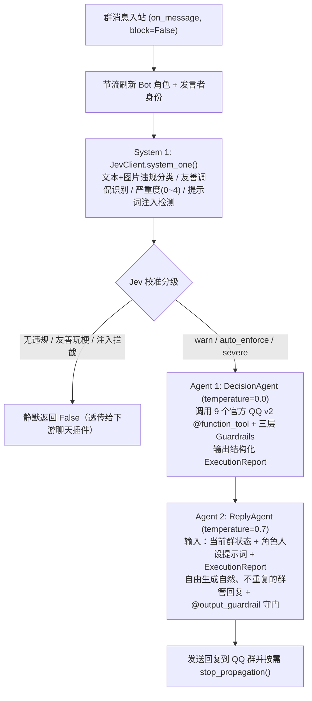

# 01. 架构设计：可注入 Jev + 双 OpenAI Agents SDK 群管体系

`opsmesh-plugin-qq-admin` 是纯群管控制应用插件（`type="application"`），**不依赖正则规则快筛，绝不参与日常闲聊**。

## 1. 全链路数据流（System 1 Jev -> Agent 1 裁决执行 -> Agent 2 角色化回复）

## 2. 为什么拆分为双 Agent

- **Agent 1 (`agents/decision_agent.py`)**：只关心“要不要管、管谁、调哪些工具”。低温度（`0.0`）保证工具调用精准稳定，受 `@input_guardrail`（Jev 注入检测）和 `@tool_input_guardrail`（8 步硬护栏 + Jev 动作证据二审）约束，只输出结构化 `ExecutionReport`，不操心文案风格。
- **Agent 2 (`agents/reply_agent.py`)**：不挂载任何写工具，只接收**当前实时状态**（群 ID、Bot 角色、今日禁言/踢人计数与上限、操作者与目标身份）、**角色人设提示词**（`resources/prompts.toml` `[reply_agent]` 或 `QQ_ADMIN__LLM__REPLY_PERSONA`）和**真实执行结果**（违规处置、权限拒绝、护栏拦截、命令反馈）。较高温度（默认 `0.7`）让每次群管回复自然贴合当下语境、避免死板复读，同时受 `@output_guardrail`（防假执行 + Jev 输出安全复核）兜底。

## 3. 可注入的 `JevClient`（`qq_admin/jev/`）

- `JevClient(config, sdk_client=...)` 统一管理 `AsyncTypeSafeClient` 与可选代理 `httpx.AsyncClient` 的启停；
- 所有评估函数（`evaluate_message`、`evaluate_join_request`、`check_input_injection`、`check_action_validity`、`check_output_safety`）与所有 Guardrail 均**通过参数显式接收 `JevClient`**，不在函数内部写死全局客户端，既方便多实例/宿主共享客户端，也让单元测试 100% 确定性可控。

## 4. 角色感知 8 步硬护栏（`moderation/guard.py`）

- **Bot 为群主（`owner`）**：跳过插件侧保护名单、冷却、每日限额与阶梯限制，以 QQ 官方接口实际校验为准；
- **Bot 为管理员（`admin`）**：强制校验 `protected_users` -> `exempt_users` -> `admin.admins` -> `auto_exempt_admins` -> `mute_cooldown` -> `daily_mute/kick_limit` -> `kick_require_member_check` -> `escalation.steps`。
