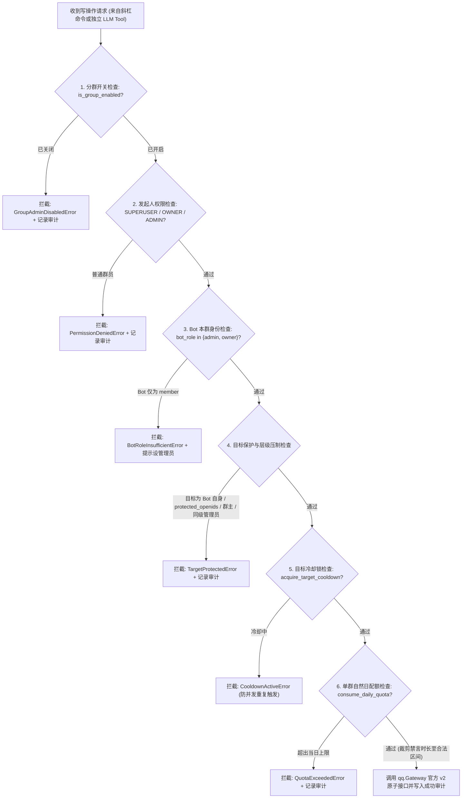
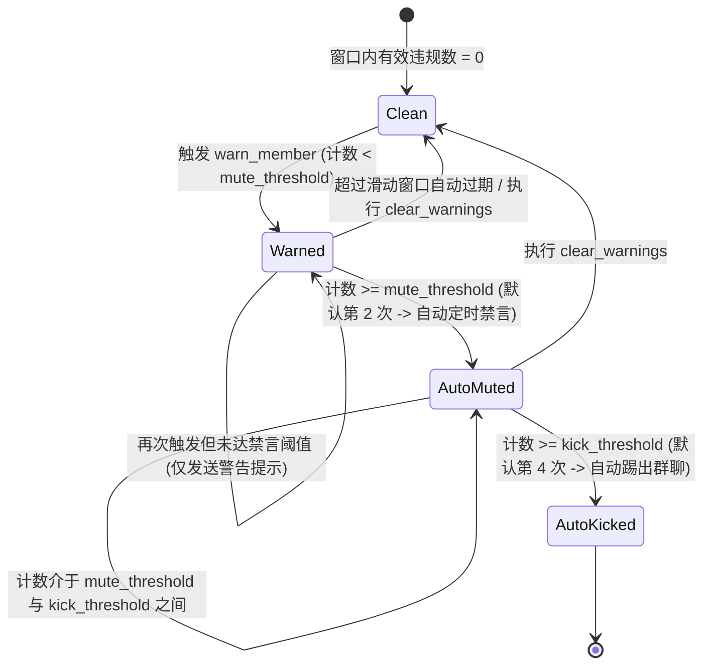
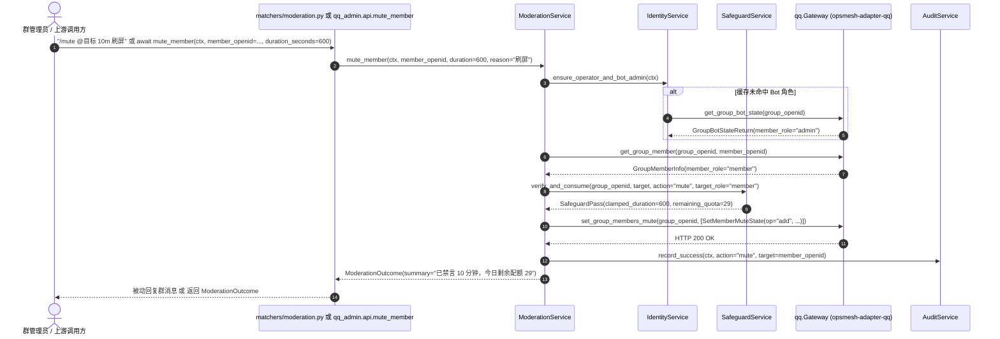
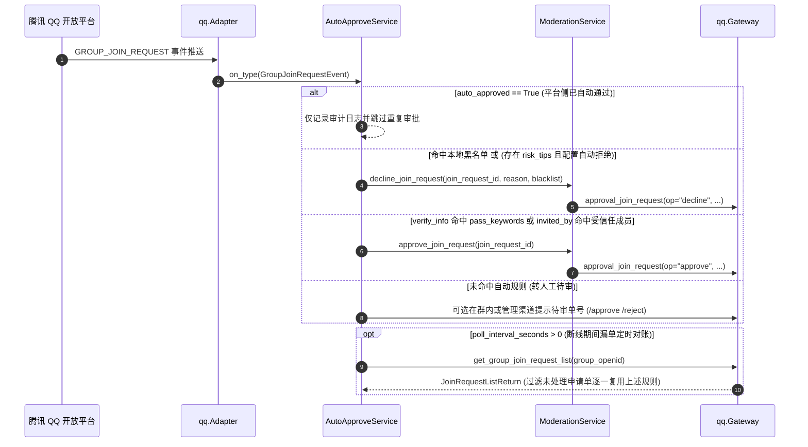

# 03. 双重权限矩阵、六阶安全护栏与核心业务时序图

本文档定义 `qq_admin.services` 的双重身份判定逻辑、高危写操作安全护栏管线、违规警告阶梯升级状态机，以及命令/Tool 统一执行与自动入群审批的完整时序流程。

---

## 1. 双重身份权限矩阵（`Operator Role × Bot Role`）

所有群管动作必须同时满足**发起人权限**与**机器人本群权限**：

| 动作分级 | 代表操作 | 发起人最低要求 (`OperatorIdentity`) | Bot 本群最低角色 (`get_group_bot_state`) | 配额与冷却约束 |
| :--- | :--- | :--- | :--- | :--- |
| **P0 系统管控** | `/admin on\|off` · 清空配额 · 豁免护栏 | `SUPERUSER` 或 `GROUP_OWNER` | `member` | 不受配额限制 |
| **P1 高危写操作** | `kick` · `add_blacklist` · `remove_blacklist` | `SUPERUSER \| GROUP_OWNER \| GROUP_ADMIN` | `admin` 或 `owner` | 强制走六阶护栏 + 每日配额 |
| **P2 常规写操作** | `mute` · `unmute` · `recall` · `approve/decline` | `SUPERUSER \| GROUP_OWNER \| GROUP_ADMIN` | `admin` 或 `owner` | 强制走六阶护栏 + 每日配额 |
| **P3 只读与审计** | `groupinfo` · `member` · `shutlist` · `audit_log` | `SUPERUSER \| GROUP_OWNER \| GROUP_ADMIN` | `member`（`banlist`/`requests` 需 `admin`） | 无配额扣减 |

---

## 2. 六阶高危动作安全护栏流程图（`SafeguardService`）

---

## 3. 滑动窗口违规警告与阶梯升级状态机（`WarningService`）

针对刷屏（`spam`）、辱骂（`abuse`）、广告（`ad`）等违规记录，在滑动时间窗 `window_seconds`（默认 24h）内自动计算有效次数并执行阶梯升级：

---

## 4. 斜杠命令与对外函数 API 统一执行时序图

---

## 5. 入群申请事件驱动 + 巡检补偿自动审批时序图（`AutoApproveService`）

